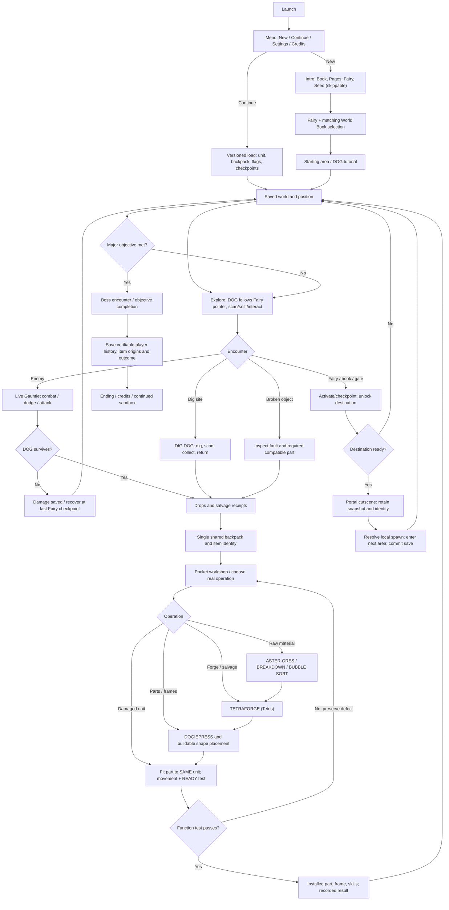
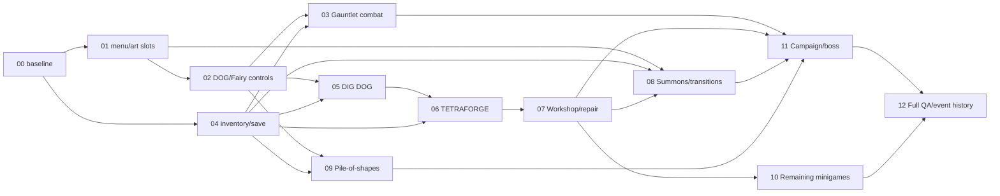

# TO DOG / GERTECH — Godot 2D playable game: flow + Work coding projects
**Status:** Owner-requested implementation map (2026-11-17). This is a build brief, not evidence that the 2D game already runs. No artwork or film source is replaced, no old 3D game is edited by this document, and no independent new canon is declared.

**Priority Zero alignment:** This complete 2D campaign slice advances modular gameplay, persistent characters and objects, recoverable event history, reusable visual assets, and real transitions between worlds. Future Ready Maker One MMORPG and film-production objectives remain separate expansions, not an excuse to delay a playable 2D game.

## Product target and current evidence
- **Playable game:** TOP-DOWN 2D / optional layered 2.5D presentation of TO DOG. Outside view of the DOG and nearby FAIRY; Gauntlet-style live exploration/combat, not the rejected first-person Godot 3D workshop. Locations and characters use selectable user-supplied pictures. No authoring new faces, no mandatory 3D scene tree.
- **Player promise:** DOG explores, fights, digs, retrieves a real identified part, processes it, installs it in the SAME damaged unit, passes a working test, saves progress, discovers a Fairy checkpoint, crosses a portal into a second area, wins a final challenge, and can continue playing. Every effect changes game state.
- **Evidence:** The November 14 TO DoG progression record lists Tetris Foundry as implemented in a LEGACY Godot 3D project, DIG DOG/Breakout as incomplete docks or partial logic, and the 2D remake as planned. The legacy source is mirrored in `godot/GERTECH_Aqua_Workshop/` but is **not** evidence of an existing playable 2D remake. Prior TO DOG fuse/door tests belong to a different prototype; any reused code must be independently imported and tested.
- **Art is replaceable, not a gate.** A deliberately plain placeholder playthrough must function completely with no selected JPEGs. A single data-driven art-slot manifest later swaps in owner-approved pictures without changing combat, coordinates, inventories, damage, spawn state or story.
- **Scope line:** first shipped game = finite, replayable 2D campaign with one completed cross-area loop. Full MMO servers, cross-engine transport to separate executable games, AI-created cinematic movies, advanced robot skins and actual volumetric 3D meshes are *separate future projects*, not silently claimed as implemented.

## Full player flowchart


## The two other essential flows
**Pocket workshop / summon transaction** (not magical free goods): `request from inventory/hand/slot/FAIRY -> find existing stock or source -> reserve exact item and amount -> open small DNA/ZIPPER seam -> capsule transferred -> repair/assemble/test at persistent quantum table -> return SAME item ID to caller -> receipt commits inventory -> seam closes`. Failure rolls back the pending transaction and preserves the last good state. Do not substitute a factory montage, duplicate the object, or use the giant cutscene portal for a tiny package. Summoned **characters** and Fairy/Book **world entry** remain distinguishable from item delivery.

**World travel / cutscene:** `checkpoint -> save universal backpack+equipment+active spawner state -> play INSIDE transition (or approved placeholder) -> resolve destinationGameId/worldId and spawnPointId -> restore destination-local flags and cooldowns -> arrive and acknowledge -> atomically commit transition`. Failed load goes back to source. No video itself is expected to serialize state. A destination world keeps its own coordinates; inventory never becomes a new copy.

## Minimum playable map and content
Use neutral internal IDs, because owner art selection may establish different locations:
- `zone_01_start`: damaged starter DOG, movement/laser-pointer tutorial, one real item/fuse puzzle, basic hostile, first salvage.
- `zone_02_field`: branching path, resource/dig site, Gauntlet combat, discover first recoverable Fairy checkpoint.
- `zone_03_workshop`: physically accounted item input, TETRAFORGE, DOGIEPRESS, repair/READY gate, inventory panel, assembly/snap yard.
- `zone_04_gate`: Fairy/World Book pairing, one summoning transaction, one travel cutscene with checkpoint.
- `zone_05_destination`: second genuinely playable area with new hazards, a boss/objective, ending/continued play.
The game must never claim a world exists because a button says "Enter" while the destination is not implemented. Existing alternative settings (Maker Frontier Lot Zero / Psyche 16 / Moon Cave) are references, not all forced into one level by this plan.


## Foundation contracts — one shared format, not six invented WorldSeeds
**Source of truth, already present:** [`UNIVERSAL_GAME_SCHEMA.json`](../UNIVERSAL_GAME_SCHEMA.json), [`UNIVERSAL_GAME_EXAMPLE.json`](../UNIVERSAL_GAME_EXAMPLE.json), and [`GAME_STANDARDS.md`](../GAME_STANDARDS.md). These are **v1 specification data, not a working save manager**. The QC assertion that no shared schema exists is too broad: v1 already defines backpack, equipment references, world-local spawning and transitions. It does **not** yet model DOG's modular identity, measured helper effects or transaction/event receipts. Do **not** fork the root schema in each minigame.
**Compatibility rule:** v1 has `additionalProperties: false` at root, `schema_version: 1`, and a legal extension container at `game_states["world:to_dog_2d"].extensions`. Put 2D-only state under `extensions.to_dog_2d` with its own `extension_version: 1`. Do not add `units`, `event_log`, `pending_transactions` or any new fields at the v1 root and then claim the document validates. Any future shared v2 requires explicit compatibility tests and migrations; do not quietly upgrade everybody's saves. Preserve all unknown game-specific extension keys unmodified on load/save and round-trip.
**One authoritative runtime owner:** WORK-04 implements `SharedWorldState` and `TransactionLedger` as **the only** mutator for inventory, units, construction and events. Minigames return a `MinigameResult` request; they never independently write a save or mint loot. All project branches call the same API. Until WORK-04 is integrated, WORK-03/05/06/07/08/09/10 can run test fixtures but cannot be marked integrated.

### Typed extension record — minimum implementable fields
- `units[unit_id]`: permanent `unit_id` (e.g. `dog:starter`), `brain_id`, `experience_id`, `body_id`, `power_id`, `interface_id`, `equipment_entry_ids`, `appearance_slot`, `fault_ids`, `ready`, `durability`. This keeps the **seven distinctions** Brain / Body / Power / Interface / Equipment / Experience / Appearance. The `unit_id` and its experience history must survive repair, gear change, chassis replacement **when a continuity-preserving replacement is actually selected**, save/reload and travel. Do not infer that copying a generic canine brain creates or replaces TO DOG. Whether a particular fictional brain transfer changes personal identity is a **story decision left unassigned**, not a programming shortcut. For the first game, the persistent `unit_id` is the technical identity carrier and no brain-transfer mechanic is enabled.
- `transactions[tx_id]`: `tx_id`, `operation`, `status` (`reserved|committed|rolled_back`), `source_world_id`, `requester_id`, `input_entry_ids_and_quantities`, `output_entry_ids_and_quantities`, `target_unit_id` (nullable), `minigame_session_id` (nullable), `helper_actor_id` (nullable), `technology_family_id` (nullable), `tier_id` (nullable), `metrics_before`, `metrics_after`, `event_id`. IDs are stable and replay-safe. Reserving does not spend the same input twice; committing debits and credits once; rollback releases the reservation. A repeated `tx_id` must return the old receipt instead of issuing another reward. Record the actual item provenance and cost, not just a score.
- `events[]`: append-only `event_id`, monotonic `tick`, `world_id`, `actor_id`, `unit_id`, `subject_id`, `event_type`, `tx_id` (nullable), `helper_actor_id` (nullable), `technology_family_id` (nullable), `tier_id` (nullable), `metrics_before`, `metrics_after`, `result` and `evidence_ref` (nullable). Core events: `item_collected`, `item_spent`, `part_forged`, `repair_test`, `construction_validated`, `helper_action`, `spawn_repaired`, `fairy_checkpoint`, `portal_travel`, `boss_defeated`. An event records an actual committed state transition; cutscenes do not generate fake history. The `tier_id` field is available without forcing an unapproved hierarchy or linking a technology family to costume color.
- `constructs[construct_id]`: `piece_ids`, `solid_ids`, `world_local_transforms`, `connector_states`, `functional_result` and `validation_revision`; save the physical 2D collision/use state in addition to visuals and graph hints.
- `fairy_world_links[link_id]`: `fairy_id`, `world_book_id`, `world_id`, `spawn_point_id`, `discovered`, `enabled`; match actual paired IDs on arrival. Color is an appearance option and is **not** a unique identity or job assignment.
- `helper_rules[station_id]`: `behavior` (`none|advisory|required`), `eligible_helper_ids` (possibly empty), `baseline_metrics`, `expected_delta`, `result_metric`, `approval_status` (`proposed|owner_selected|verified`). `advisory` allows solo operation, optionally with a measured bonus. `required` blocks a specific operation if its approved prerequisite is missing. **Default to advisory/no bonus** in the first playable game; never convert suggested Rat/Gold/Blue/Rooster job allocations into owner-approved locks.
- `MinigameResult`, produced by EVERY station: `session_id`, `station_id`, `recipe_id`, `input_entries`, `status` (`success|failure|cancelled`), `raw_score`, `metrics`, `helper_actor_id` (nullable), `tier_id` (nullable), and `requested_output`. WORK-04 validates inventory, recipe, availability, thresholds, helper rules and receipt; it alone issues the resulting `tx_id` and accepted event. No free parts on failure or repeated click.
**Measurement contract:** Each helper or station claim names an observable variable, a before value, an after value and its effect **in the next playable room** (e.g. `durability +5` changes a leg's load-test threshold; a revealed hidden salvage marker persists after save; an electrical connection test either passes or fails). A completion screen or high score without observable downstream effect does not pass. Compare no-helper baseline to with-helper result with identical seed and starting inventory; report deltas and any gating rule. The first acceptance test is deliberately **solo-only**; it does not validate helpers.

### Technology-family / Fairy ownership boundary
The QC text names “six technology families” and suggests Rat scout, Gold lattice verify, Blue containment, Rooster inspect and Probe scouting. Those are **candidate work-role mappings**, not proof that the owner locked six exclusive Fairy owners. Existing Fairy/AI agent identities and selected emblems must not be overwritten by technology roles; historical color locks were explicitly withdrawn. Store `helper_actor_id` and `technology_family_id` separately. Work may add helper behavior using neutral test actors, but may not hard-code Rat/Gold/Blue/Rooster ownership, compulsory gates or permanent palette assignments without a traceable owner-selected mapping. Lack of such a mapping does **not** block the solo campaign or standard save format.

### WORK-01 picture resolution contract
`res://data/art_slots.json` maps logical slot IDs to a candidate `res://` resource, optional animation frames, anchor/pivot, and fallback slot. `ArtRegistry.gd` resolves the slot at scene load and warns once for a missing/invalid picture; it displays a recognizable placeholder rather than blocking the game. No physics, collision, stats, inventory or identity are inferred from image pixels. A chosen art preference may be stored separately in `user://art_choices.json`, not as an item in the universal backpack. Runtime local JPG/PNG selection may be supported from a private `user://art/` folder via Godot's Image/ImageTexture loader; packaged `res://` paths must exist at export time. Do **not** assume changing an unimported JPEG automatically changes a shipped binary, or copy private original artwork into a public repository. The first WORK-01 release may be manifest/folder based; an in-game file browser is not required until explicitly selected.

### Helper integration acceptance — separate from solo milestone
After WORK-04 + WORK-05 + WORK-07: with identical starting save, a selected scout helper reveals a hidden salvage location and emits an authoritative `helper_action` event. DOG then visits, recovers its real `entry_id`, and WORK-07 tests the repaired original DOG. Save/quit/reopen must preserve both location discovery and the same installed part. Repeat with helper absent: the operation follows its explicitly configured `advisory` or `required` rule, and no phantom salvage appears. A Gold lattice-verification demonstration or Blue containment/Rooster inspection demonstration is **optional until owner-selected**; each must have its own measurable before/after test, not merely a colored icon.

### Trace the candidate next steps without inventing another required project
| Earlier candidate | Delivery home | Gate |
|---|---|---|
| Fairy pointer / control interface | WORK-02; actual pairing/travel in WORK-08 | Core build |
| Rat-style salvage scout | WORK-05, helper adapter | Proposed, no fixed Rat owner |
| Gold-style lattice verification | WORK-07, functional test | Proposed, do not color-lock |
| Blue-style containment | WORK-10, JezzBall/vacuum adapter | Proposed optional station |
| Rooster-style inspection | WORK-10, diagnostics adapter | Proposed optional station |
| Probe scouting | WORK-05, independent prospecting/scan mode | Explicit subtask, not forgotten; no extra WORK-13 until owner selects larger scope |

## Work readiness map — do not accept integration by implication
| Project | Code readiness | Cannot be claimed complete until |
|---|---|---|
| WORK-00 | UNBLOCKED | Fresh Godot 2D project actually launches |
| WORK-01 | UNBLOCKED after the art contract above | Menu, intro and JPEG/PNG swap tested |
| WORK-02 | UNBLOCKED | Same DOG and Fairy pointer move/interact |
| WORK-03 | SOLO COMBAT BUILDABLE | Loot/respawn integration uses WORK-04's real API |
| WORK-04 | FOUNDATION CONTRACT NOW SPECIFIED; IMPLEMENTATION OPEN | v1-compatible extension, ledger, migrations and round-trip tests actually pass |
| WORK-05 | SOLO BUILDABLE after 02+04; HELPER OPTIONAL | Extract/return receipt proven; optional scout has measured effect |
| WORK-06 | AFTER 04+05 | One Tetris round consumes input and produces exactly one actual item |
| WORK-07 | AFTER 04+06 | Original DOG identity and installed part survive repair/save |
| WORK-08 | AFTER 01+04+07 | One live summon and a rollback-safe portal handoff |
| WORK-09 | AFTER 02+04 | Functional placed/saved construction, not just a drawn graph |
| WORK-10 | AFTER 04+06+07; OPTIONAL STATIONS MAY SHIP LATER | Per-station accepted result and end-to-end inventory receipt |
| WORK-11 | AFTER 03+07+08+09 | Full finite campaign completed from fresh save |
| WORK-12 | AFTER 04+11 and tested station adapters | Recorded history, complete runtime QC and release evidence |
No Work ticket should be blocked merely because a document proposes an exclusive color/tier owner. The runtime blocker is missing tested code, not permission to invent canon.

## Shared game state contracts (implement once)
**Runtime implementation:** WORK-04 must implement the shared v1-compatible extension described immediately above. The field lists below summarize the player-facing required behavior; they are **not permission to add forbidden fields to the v1 root**.
`ItemDefinition{id, category, properties}`; `ItemEntry{entry_id, definition_id, quantity, instance_data}`; `EquippedSlot{slot_id, backpack_entry_id}`. The shared backpack has no arbitrary slot cap; every equipment link points to the same entry and every debit/receipt is committed once.
`UnitState` stays under the same `unit_id` through damage, fitting, READY testing, persistence and return. Keep Brain, Body, Power, Interface, Equipment, Experience, Appearance distinct. A different render or a replaced part is not a new DOG; a speculative brain copy is not silently the original DOG.
`WorldState` remains namespaced by world, including checkpoint, spawners, waves/cooldowns, constructions and portal-link status. `GameEvent` captures the before/after outcome, provenance and any helper/tier IDs as optional descriptive fields, **only after success**. Version migration and deliberate reset must both be tested.
`WorldSeedPiece` is an actual selected, inventory-backed, placeable 2D construction part with collision outline, real connectors and saved transform. Graph math can assist snapping but is never itself the deliverable.
**Explicit retention boundary:** Keep rejected experiments as historical references, not live implementation dependencies. No automatic resurrection of the failed 3D WorldSeeder as the 2D gameplay foundation.

## Art selection is the OWNER'S last stage
Implement `res://data/art_slots.json` and `ArtRegistry.gd` with fallbacks. No art path hardcoded in game logic. Support one file per slot or a sprite-sheet+frame metadata. Give each placeholder a stable slot ID, screen placement and visible frame box so Ryan can select pictures without new code.
```
intro.pages_sequence       -> opening selected frames / stills (skippable)
ui.title / ui.inventory    -> title screen and HUD overlays
actors.dog.idle / run / hurt / repaired
actors.fairy.pointer / active / portal / summon
actors.monkey / ox / goat (later party)
areas.zone_01..zone_05.background, foreground, collision_mask
objects.item / broken_part / repaired_part / resource / capsule
objects.dna_zipper / portal_ring / world_book / fairy_checkpoint
objects.five_solids.[tetra,cube,octa,dodeca,icosa]
minigames.tetraforge / dig_dog / breakdown / bubble_sort / aster_ores / dogiepress
cutscene.inside_01..04 / ending
sound.fairy / shop / compressor / portal / impact / combat / song
```
Don't publish private original JPEGs to the public code repository. When the owner chooses images, put them in a local/private art folder ignored by Git, maintain an asset manifest mapping local sources to slots, and produce export-safe derivatives only with consent. Pictures can change independently of save compatibility.

## Work project boundaries — each branch/PR is independently testable
These are **coding assignments**, not completed features and not a mandate to issue every ticket immediately. Execute in dependency order; don't spin up another 3D rewrite or a new dashboard.

### WORK-00 — 2D repository baseline and honest import
**Depends:** none. **Build:** create `godot/TO_DOG_2D/` as a standalone Godot 4.x 2D project. Inspect/reuse the old code only after testing; keep `godot/GERTECH_Aqua_Workshop/` untouched. Establish headless parser/import check, main scene, test fixture, input map, scene tree, placeholder textures; note exactly what can and cannot be ported.
**Pass:** project opens in the installed Godot engine without parse errors, launches to an actual controllable empty 2D room, and a clean fresh copy starts without private assets.

### WORK-01 — Screen flow and picture replacement system
**Depends:** 00. **Build:** Title/New/Continue/Pause/Settings; skippable Pages/Book/Fairy intro with an actual transition to game; `ArtRegistry.gd`, `art_slots.json` and optional private `user://art_choices.json`; configurable resource/atlas paths, reliable placeholder warnings, full-viewport/room background management and correct aspect ratios/anchor points. Picture selection is initially a manifest/private-folder choice, not an invented mandatory in-game editor; one user-selected JPG or PNG swap must affect only presentation.
**Pass:** all menu buttons operate, game starts/continues, intro skips/replays correctly, art can be replaced by editing manifest with no gameplay script modification.

### WORK-02 — DOG, Fairy pointer, exploration and physical interactions
**Depends:** 01. **Build:** `CharacterBody2D` DOG, camera, collisions, mouse/keyboard/gamepad controls, 2D aim/laser pointer and command target, sniff/scan/select, pickups with proximity, interactive gates/doors; optional single-screen switch between DOG and Fairy interface without inventing a second body.
**Pass:** DOG moves, stops at walls, points/inspects a named part, carries it to an actual trigger; no first-person camera.

### WORK-03 — Gauntlet combat, hazards and death/respawn
**Depends:** 02; item API from 04. **Build:** real-time attacks/dodge, enemy movement, hit/hurt invulnerability, damage types, limited simultaneous spawns, combat pickups, one miniboss, a checkpoint respawn that preserves the correct previous state. Gauntlet is chosen for active combat; Shining Force tactics stays a separate unselected branch.
**Pass:** one full fight won/lost; damage/loot verifiable; death returns to discovered Fairy checkpoint without granting duplicate drops.

### WORK-04 — Portable backpack, saves, states and spawners
**Depends:** 00 and the **Foundation contracts** in this file. **Build:** implement `GAME_STANDARDS.md` + existing v1 `UNIVERSAL_GAME_SCHEMA.json` as Godot data/runtime services. Store units, tier-aware events, helper records and transactions **only** under `game_states["world:to_dog_2d"].extensions.to_dog_2d`, with strict cross-reference checks; implement stable unique item entries, equipment references, unlimited logical inventory, idempotent transaction ledger, world-local spawners, checkpoints, wave persistence, atomic save, explicit version migration and deliberate reset. Minigames must call this single service, never invent separate saves.
**Pass:** collect 3 items, equip one, save/quit/reopen with identical ID/reference links; spend exactly one, request the SAME transaction twice and verify no duplicate payout; round-trip an unknown extension from another world without losing it; corrupted/failed load preserves prior good save; migration explicitly reports success or refusal; clean reset resets while ordinary restart does not. Verify the resulting JSON against the v1 schema and runtime cross-reference checks.

### WORK-05 — DIG DOG, mining and resource transactions
**Depends:** 02+04. **Build:** complete 2D DIG DOG dig/extract/return with collisions, scanner, risks, material objects and bounded resource receipts through WORK-04; optional ASTER-ORES panel remains in WORK-10. **Explicit helper subtask:** provide a selectable, separately recorded scout/probe prospecting interaction (Rat-themed only if owner-selected), yielding a durable discovered site/part ID; do not silently require it for solo play.
**Pass:** enter dig site, mine a particular entry ID, return it home; inventory increments once, reusing session/transaction ID gives no second reward, failed/aborted digs mint nothing, and saved results survive restart. Optional probe/helper mode must mark a hidden site persistently and report the difference versus an identical no-helper baseline.

### WORK-06 — TETRAFORGE / salvage recovery, actual game outputs
**Depends:** 04+05. **Build:** test and port the existing 10x20 Tetris Foundry into its own 2D scene, with hold/rotation/row clearing and a known input-output recipe. Implement distinct manufacture and salvage modes only when both work. A damaged/high-tier salvage board may be prefilled; one claim per salvage record. No "Tetris = manufacturing" label without an actual produced piece.
**Pass:** player spends input stock, plays Tetris, receives exactly one documented part or forged blank, installs/trades it in another scene; failed recovery remains unresolved. Save/reload preserves stock and salvage claim state.

### WORK-07 — Workshop, DOGIEPRESS, same-unit repair and READY door
**Depends:** 04+06. **Build:** inventory intake, part compatibility, DOGIEPRESS assembly, fault inspection, physical installation in the original `unit_id` while preserving brain and experience identifiers, observable movement/load test, READY signal, gated exit only upon success. Separate optional lattice-verification helper adapter with measured electrical/structural connectivity; no fixed Fairy/Gold owner implied. Show pre/post appearance through art slots, not unexplained morphing.
**Pass:** begin with broken DOG, recover/forge compatible component, fit it, pass movement/READY, open door, walk out with SAME unit ID and saved installed part; wrong part and failed test leave the identifiable broken state.

### WORK-08 — Fairy, World Book pairing, summon ZIPPER and portal travel
**Depends:** 01+04+07. **Build:** Fairy checkpoints, book-to-fairy ID match, discovered spawn selection; summoning via exact stock reservation and small local DNA-helix capsule transit; skippable in-engine cutscene placeholders for the documented four INSIDE travel beats; state handoff to zone_05. Fairy is a player-side actor with meaningful input, not merely a glowing respawn marker.
**Pass:** correct pairing opens gate; wrong pairing does not; summon sends an item with source ID and returns same item; inventory unaffected by the cutscene; travel + return preserve equipment, active wave and previous checkpoint; deliberate failure rolls back.

### WORK-09 — World Seed Pile of Shapes: playable construction
**Depends:** 02+04. **Build:** follow the owner picture's progression **raw triangular pieces → assembled panels → first complete tetrahedron (four triangular faces) → functional modular block → additional five-solid families**. Generate seeded, distinct inventory-backed, **placeable 2D depictions** of tetrahedron/cube/octahedron/dodecahedron/icosahedron with snap connectors, collision outlines, rotation, saved placement and tangible construction functions. Respect real face geometry: cube has square faces and dodecahedron pentagonal faces, so advanced face-panel assembly is required rather than pretending all five solids are made directly from triangular faces. Gameplay must include the actual assembly/unlock step and a traversable bridge/support/relay. A diagram of 5 shapes or decorative graph fails.
**Pass:** player collects four triangle faces, assembles a tetrahedron, unlocks its specific linkage/bracing function, places and snaps it into a bridge/relay, visibly gains access to a previously blocked path, and saves/reloads with identical geometry and functionality. A separate test instantiates all five valid solid families as functional pieces. This 2D game does **not** claim to generate volumetric 3D meshes; that is a distinct later 3D game/export acceptance test.

### WORK-10 — Remaining workshop arcade stations and physical pipeline
**Depends:** 04+06+07. **Build:** ASTER-ORES → BREAKDOWN → BUBBLE SORT → TETRAFORGE → DOGIEPRESS → DIG DOG as discrete, testable scene adapters using the canonical `MinigameResult` and WORK-04 ledger, not new inventory formats. Bejeweled/glass-spacer, JezzBall/Blue-style containment, Rooster-style inspect, SHAKE TABLE, HOPPER, SHIELD GRID, TORUS RUN and Tower Catch remain **separate optional candidate stations**. Select required/advisory/no-helper behavior per approved recipe, and explicitly measure downstream effect; no fixed agent/color ownership.
**Pass:** each implemented station runs from its own scene and produces one validated `MinigameResult` with before/after measures; one input debit and bounded output receipt happen through the shared ledger; cancel/fail and replay cannot create free parts. The next station consumes the actual output item ID. Optional helper version compares seeded with/without-helper outcomes and records one verified `helper_action` event.

### WORK-11 — Frames, progression, quests and complete campaign
**Depends:** 03+07+08+09. **Build:** DOG-based starting run; unlock selectable dog, monkey, ox and goat frame options with distinct movement/task roles and upgrades; preserve alternative evolution directions (werewolf / Monkey King / Minotaur / satyr) as named design choices, not prematurely forced skins. Implement zone objectives, one genuine destination map, major gate challenge, final playable boss, ending and continued play.
**Pass:** fresh save can reach credits without developer commands, all gates require actual earned actions, checkpoint after boss persists, equipment and world changes remain after continuing.

### WORK-12 — Event history, replay/cinematic hooks and full QA
**Depends:** 04+11 and every included station adapter. **Build:** use WORK-04's event schema from the start (do not retrofit a second log); verify event IDs, transaction references, repair, spawn, gate, boss, item lineage and selected helper metrics; optional capture references do not imply MP4 rendering. Install approved owner pictures only after selection; include settings, volume, accessibility, pause/gamepad and export targets. Run solo and helper acceptance independently.
**Pass:** a tester can complete New→DOG→Fight→Dig→Tetris→Repair→Fairy Gate→New World→Boss→Credits→Continue, then restart and confirm correct save data. Provide runnable build/project, reproduction commands, screenshots or clips of ACTUAL play, inventory before/after receipts and a list of any failures. "Wrote code" is not a pass.

## Dependency order for Work

**Suggested sequence:** 00 first, then 04 implementing the written foundation contract (parallel with 01 art/menus); 02 follows 01. WORK-03 can prototype solo combat while WORK-04 is underway but cannot merge its loot/respawn until the shared API passes. All Work scopes integrate through the same public interfaces. Work should use an isolated branch per code project and return one runnable PR with tests, not overwrite other windows' efforts. Work may implement independent projects in parallel only after their shared interfaces are verified. Do not accept task reports as a game. Do not require owner artwork before first playable acceptance.

## Milestone scopes — prove SOLO before HELPERS
**Milestone A — solo complete loop:** Launch → DOG moves/inspects → recover real item → spend/forge once → install in SAME DOG → load/READY test → door opens → save/quit/reopen. No helper is required or evaluated. A saved success does not depend on selected pictures.
**Milestone B — helper comparison:** Same initial save/seed → scout/probe (or owner-selected helper) creates a measured, persisted discovery → DOG recovers item → optional verification changes measured test result → save/quit/reopen retains helper event, part lineage and unit identity. Compare the identical solo branch: no helper cannot generate unearned resources. This milestone is separate and may be deferred without falsely downgrading the completed solo game.
**Milestone C — full campaign:** Start through ending and continued play, including functional solid construction, a real Fairy/Book match, a paid item summon and a rollback-safe portal transfer. Never call mere scenes or screenshots completed features.

## Demonstration contract for every Work project
Each completed project delivers **(1)** source diff/PR, **(2)** exact scene to launch, **(3)** playable test steps, **(4)** actual observed result, **(5)** screenshots/video where applicable, **(6)** save/load or inventory proof if relevant, **(7)** what remains unimplemented. Any unverified feature must say UNVERIFIED. All work should be judged against the player result, not number of scripts or lines of code. Preserve original names and do not silently rewrite game or film routes.

## Pointers to existing source, not new orders
- [TO DoG November 14 progression/build status](https://docs.google.com/document/d/1gViV-yWNjBvTyECS9IbEqRW9yKdGfHzmjcPhU-3KFsA/edit)
- [TO DoG reopens — 2D/Gauntlet design](https://docs.google.com/document/d/1C1f_7mg65xglUb1oFOO1XDxISNg9BBlC8vYTCGVWmkA/edit)
- [Universal game standards](https://github.com/IsekaiSensei/to-world-open-crew/blob/main/GAME_STANDARDS.md)
- [Legacy Godot source (3D, test before porting)](https://github.com/IsekaiSensei/to-world-open-crew/tree/main/godot/GERTECH_Aqua_Workshop)
- [INSIDE world transition source](https://drive.google.com/file/d/1F84FojD5-Z_abwLceqAiZ7YgqexctfYr/view)
- [Pocket workshop / ZIPPER transaction source](https://docs.google.com/document/d/1ymWBkLpCUFKxxHcsjjVdhullaIW4eXbvVrpBZfsrXkY/edit)
- [World Bible start here](https://docs.google.com/document/d/1wiIjBtDvhunHwL7XHHaK-IFejjtd4SeIq-0z6vG7ofE/edit?tab=t.wg1zu1339jhg)
