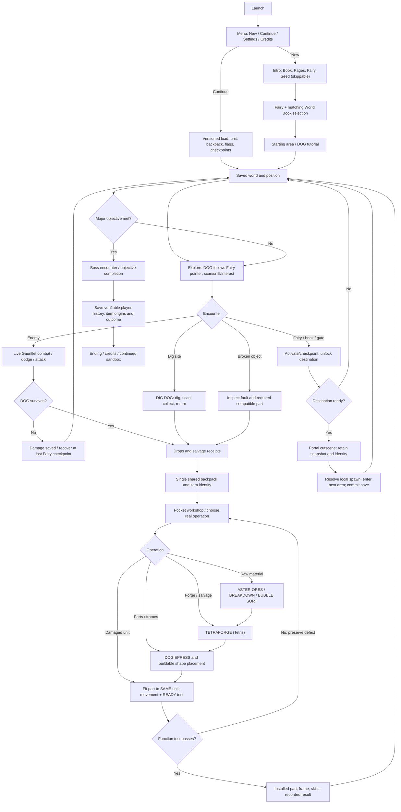
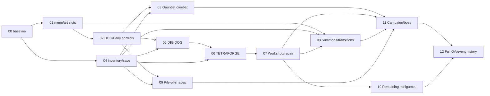

# TO DOG / GERTECH — Godot 2D playable game: flow + Work coding projects
**Status:** Owner-requested implementation map (2026-11-17). This is a build brief, not evidence that the 2D game already runs. No artwork or film source is replaced, no old 3D game is edited by this document, and no independent new canon is declared.

**Priority Zero alignment:** This complete 2D campaign slice advances modular gameplay, persistent characters and objects, recoverable event history, reusable visual assets, and real transitions between worlds. Future Ready Maker One MMORPG and film-production objectives remain separate expansions, not an excuse to delay a playable 2D game.

## Product target and current evidence
- **Playable game:** TOP-DOWN 2D / optional layered 2.5D presentation of TO DOG. Outside view of the DOG and nearby FAIRY; Gauntlet-style live exploration/combat, not the rejected first-person Godot 3D workshop. Locations and characters use selectable user-supplied pictures. No authoring new faces, no mandatory 3D scene tree.
- **Player promise:** DOG explores, fights, digs, retrieves a real identified part, processes it, installs it in the SAME damaged unit, passes a working test, saves progress, discovers a Fairy checkpoint, crosses a portal into a second area, wins a final challenge, and can continue playing. Every effect changes game state.
- **Evidence:** The November 14 TO DoG progression record lists Tetris Foundry as implemented in a LEGACY Godot 3D project, DIG DOG/Breakout as incomplete docks or partial logic, and the 2D remake as planned. The legacy source is mirrored in `godot/GERTECH_Aqua_Workshop/` but is **not** evidence of an existing playable 2D remake. Prior TO DOG fuse/door tests belong to a different prototype; any reused code must be independently imported and tested.
- **Art is replaceable, not a gate.** A deliberately plain placeholder playthrough must function completely with no selected JPEGs. A single data-driven art-slot manifest later swaps in owner-approved pictures without changing combat, coordinates, inventories, damage, spawn state or story.
- **Scope line:** first shipped game = finite, replayable 2D campaign with one completed cross-area loop. Full MMO servers, cross-engine transport to separate executable games, AI-created cinematic movies, advanced robot skins and actual volumetric 3D meshes are *separate future projects*, not silently claimed as implemented.

## Full player flowchart


## The two other essential flows
**Pocket workshop / summon transaction** (not magical free goods): `request from inventory/hand/slot/FAIRY -> find existing stock or source -> reserve exact item and amount -> open small DNA/ZIPPER seam -> capsule transferred -> repair/assemble/test at persistent quantum table -> return SAME item ID to caller -> receipt commits inventory -> seam closes`. Failure rolls back the pending transaction and preserves the last good state. Do not substitute a factory montage, duplicate the object, or use the giant cutscene portal for a tiny package. Summoned **characters** and Fairy/Book **world entry** remain distinguishable from item delivery.

**World travel / cutscene:** `checkpoint -> save universal backpack+equipment+active spawner state -> play INSIDE transition (or approved placeholder) -> resolve destinationGameId/worldId and spawnPointId -> restore destination-local flags and cooldowns -> arrive and acknowledge -> atomically commit transition`. Failed load goes back to source. No video itself is expected to serialize state. A destination world keeps its own coordinates; inventory never becomes a new copy.

## Minimum playable map and content
Use neutral internal IDs, because owner art selection may establish different locations:
- `zone_01_start`: damaged starter DOG, movement/laser-pointer tutorial, one real item/fuse puzzle, basic hostile, first salvage.
- `zone_02_field`: branching path, resource/dig site, Gauntlet combat, discover first recoverable Fairy checkpoint.
- `zone_03_workshop`: physically accounted item input, TETRAFORGE, DOGIEPRESS, repair/READY gate, inventory panel, assembly/snap yard.
- `zone_04_gate`: Fairy/World Book pairing, one summoning transaction, one travel cutscene with checkpoint.
- `zone_05_destination`: second genuinely playable area with new hazards, a boss/objective, ending/continued play.
The game must never claim a world exists because a button says "Enter" while the destination is not implemented. Existing alternative settings (Maker Frontier Lot Zero / Psyche 16 / Moon Cave) are references, not all forced into one level by this plan.

## Shared game state contracts (implement once)
`ItemDefinition{id, category, properties}`; `ItemEntry{entry_id, definition_id, quantity, instance_state}`; `EquippedSlot{slot_id, backpack_entry_id}`. The single backpack is not capped by artificial slot count. Every receipt or debit is atomic; no item count below zero. Unsupported items persist.
`UnitState{unit_id, frame_id, installed_parts:entry_ids, health, durability, abilities, damage_state, ready}`; repair and failure affect the original unit ID, not a fresh prefab. `WorldState{world_id, gates, switches, opened_doors, constructions, spawner_states, spawn_points, checkpoint}`; spawners retain wave, cooldown and alive state through travel.
`SaveGame{schema_version, active_world_id, active_spawn_id, backpack, units, worlds, pending_transactions, event_log}`; migration/version checks; atomic save and explicit factory reset. `GameEvent{id, time_or_tick, world, actor_id, target_id, action, before, after, item_origin}`; this is history for future cinematics, not an automatic movie.
`WorldSeedPiece{piece_id, solid_type (tetrahedron/cube/octahedron/dodecahedron/icosahedron), material, 2D_transform, connectors, collision_outline, inventory_entry_id}`. The displayed 2D object must be placeable, snap/rotate, and persist; this does not magically create a volumetric 3D mesh. A structure built from pieces must perform a testable job (bridge, support, relay, workbench), not solely decorate a graph.

## Art selection is the OWNER'S last stage
Implement `res://data/art_slots.json` and `ArtRegistry.gd` with fallbacks. No art path hardcoded in game logic. Support one file per slot or a sprite-sheet+frame metadata. Give each placeholder a stable slot ID, screen placement and visible frame box so Ryan can select pictures without new code.
```
intro.pages_sequence       -> opening selected frames / stills (skippable)
ui.title / ui.inventory    -> title screen and HUD overlays
actors.dog.idle / run / hurt / repaired
actors.fairy.pointer / active / portal / summon
actors.monkey / ox / goat (later party)
areas.zone_01..zone_05.background, foreground, collision_mask
objects.item / broken_part / repaired_part / resource / capsule
objects.dna_zipper / portal_ring / world_book / fairy_checkpoint
objects.five_solids.[tetra,cube,octa,dodeca,icosa]
minigames.tetraforge / dig_dog / breakdown / bubble_sort / aster_ores / dogiepress
cutscene.inside_01..04 / ending
sound.fairy / shop / compressor / portal / impact / combat / song
```
Don't publish private original JPEGs to the public code repository. When the owner chooses images, put them in a local/private art folder ignored by Git, maintain an asset manifest mapping local sources to slots, and produce export-safe derivatives only with consent. Pictures can change independently of save compatibility.

## Work project boundaries — each branch/PR is independently testable
These are **coding assignments**, not completed features and not a mandate to issue every ticket immediately. Execute in dependency order; don't spin up another 3D rewrite or a new dashboard.

### WORK-00 — 2D repository baseline and honest import
**Depends:** none. **Build:** create `godot/TO_DOG_2D/` as a standalone Godot 4.x 2D project. Inspect/reuse the old code only after testing; keep `godot/GERTECH_Aqua_Workshop/` untouched. Establish headless parser/import check, main scene, test fixture, input map, scene tree, placeholder textures; note exactly what can and cannot be ported.
**Pass:** project opens in the installed Godot engine without parse errors, launches to an actual controllable empty 2D room, and a clean fresh copy starts without private assets.

### WORK-01 — Screen flow and picture replacement system
**Depends:** 00. **Build:** Title/New/Continue/Pause/Settings; skippable Pages/Book/Fairy intro with an actual transition to game; `ArtRegistry.gd` and `art_slots.json`; full-viewport/room background management; correct aspect ratios/anchor points; one user-chosen JPG or PNG swap must affect only art.
**Pass:** all menu buttons operate, game starts/continues, intro skips/replays correctly, art can be replaced by editing manifest with no gameplay script modification.

### WORK-02 — DOG, Fairy pointer, exploration and physical interactions
**Depends:** 01. **Build:** `CharacterBody2D` DOG, camera, collisions, mouse/keyboard/gamepad controls, 2D aim/laser pointer and command target, sniff/scan/select, pickups with proximity, interactive gates/doors; optional single-screen switch between DOG and Fairy interface without inventing a second body.
**Pass:** DOG moves, stops at walls, points/inspects a named part, carries it to an actual trigger; no first-person camera.

### WORK-03 — Gauntlet combat, hazards and death/respawn
**Depends:** 02; item API from 04. **Build:** real-time attacks/dodge, enemy movement, hit/hurt invulnerability, damage types, limited simultaneous spawns, combat pickups, one miniboss, a checkpoint respawn that preserves the correct previous state. Gauntlet is chosen for active combat; Shining Force tactics stays a separate unselected branch.
**Pass:** one full fight won/lost; damage/loot verifiable; death returns to discovered Fairy checkpoint without granting duplicate drops.

### WORK-04 — Portable backpack, saves, states and spawners
**Depends:** 00. **Build:** port `GAME_STANDARDS.md` + JSON schema to Godot data and runtime services: unique item entries, equipment references, unlimited logical inventory, item transaction receipts, world-local spawn templates, checkpoint and wave persistence, atomic save + deliberate reset.
**Pass:** collect 3 items, equip one, save/quit/reopen, inventory and equipment IDs identical; spend one and verify debit; failed load leaves prior save intact; clean reset truly resets the game, while a normal restart does not.

### WORK-05 — DIG DOG, mining and resource transactions
**Depends:** 02+04. **Build:** a complete 2D DIG DOG dig/extract/return game with collisions, material objects, scanner, risk/reward, deterministic outcome and bounded resource receipts; optional ASTER-ORES arcade panel may be scoped into WORK-10. Pickups send actual IDs to backpack.
**Pass:** enter dig site, mine a part, return it home, inventory increments once; failure cannot mint resources; reopening the game preserves results.

### WORK-06 — TETRAFORGE / salvage recovery, actual game outputs
**Depends:** 04+05. **Build:** test and port the existing 10x20 Tetris Foundry into its own 2D scene, with hold/rotation/row clearing and a known input-output recipe. Implement distinct manufacture and salvage modes only when both work. A damaged/high-tier salvage board may be prefilled; one claim per salvage record. No "Tetris = manufacturing" label without an actual produced piece.
**Pass:** player spends input stock, plays Tetris, receives exactly one documented part or forged blank, installs/trades it in another scene; failed recovery remains unresolved. Save/reload preserves stock and salvage claim state.

### WORK-07 — Workshop, DOGIEPRESS, same-unit repair and READY door
**Depends:** 04+06. **Build:** inventory intake, part compatibility, DOGIEPRESS assembly, fault inspection, physical installation of recovered part into original `unit_id`, observable movement/load test, READY signal, gated exit only upon successful repair. Show pre/post installed appearance through art slots, not instant unexplained morphing.
**Pass:** begin with broken DOG, recover/forge compatible component, fit it, pass movement/READY, open door, walk out with SAME unit ID and saved installed part; wrong part and failed test leave the identifiable broken state.

### WORK-08 — Fairy, World Book pairing, summon ZIPPER and portal travel
**Depends:** 01+04+07. **Build:** Fairy checkpoints, book-to-fairy ID match, discovered spawn selection; summoning via exact stock reservation and small local DNA-helix capsule transit; skippable in-engine cutscene placeholders for the documented four INSIDE travel beats; state handoff to zone_05. Fairy is a player-side actor with meaningful input, not merely a glowing respawn marker.
**Pass:** correct pairing opens gate; wrong pairing does not; summon sends an item with source ID and returns same item; inventory unaffected by the cutscene; travel + return preserve equipment, active wave and previous checkpoint; deliberate failure rolls back.

### WORK-09 — World Seed Pile of Shapes: playable construction
**Depends:** 02+04. **Build:** generate a seed-dependent pile of 5 supported Platonic-solid types as **2D depicted, inventory-backed parts** with selection, drag/pickup, rotate, snap/connectors, collision polygons and persistent placement. Build a supported bridge/support/relay that changes traversability or available interaction. Old vertices/edges may aid connector validation but are not the player-facing product.
**Pass:** player collects three different solids, places/rotates/snaps them to finish a functional path/relay, walks through or activates it, saves and reloads with geometry and function intact. Explicitly do not claim true 3D volumetric export in this 2D build.

### WORK-10 — Remaining workshop arcade stations and physical pipeline
**Depends:** 04+06+07. **Build:** ASTER-ORES → BREAKDOWN → BUBBLE SORT → TETRAFORGE → DOGIEPRESS → DIG DOG as separate scene adapters through one inventory API. Implement Bejeweled (glass spacers) and JezzBall (vacuum isolation) later without inventing current completion; other named stations are optional extensions. Each station must visibly consume and return a real material or part, not just display score.
**Pass:** each implemented station can be completed from menu, one input ledger debit and one bounded output receipt occur, cancel/fail cannot create free parts; inputs and outputs can flow into next station.

### WORK-11 — Frames, progression, quests and complete campaign
**Depends:** 03+07+08+09. **Build:** DOG-based starting run; unlock selectable dog, monkey, ox and goat frame options with distinct movement/task roles and upgrades; preserve alternative evolution directions (werewolf / Monkey King / Minotaur / satyr) as named design choices, not prematurely forced skins. Implement zone objectives, one genuine destination map, major gate challenge, final playable boss, ending and continued play.
**Pass:** fresh save can reach credits without developer commands, all gates require actual earned actions, checkpoint after boss persists, equipment and world changes remain after continuing.

### WORK-12 — Event history, replay/cinematic hooks and full QA
**Depends:** 01–11. **Build:** event IDs on receipt, repair, spawn, gate, boss and item lineage; optional capture references, no invented MP4 output. Install approved user pictures after selection; include settings, volume, accessibility, pause, gamepad checks and export targets. One end-to-end automated and manual acceptance sheet.
**Pass:** a tester can complete New→DOG→Fight→Dig→Tetris→Repair→Fairy Gate→New World→Boss→Credits→Continue, then restart and confirm correct save data. Provide runnable build/project, reproduction commands, screenshots or clips of ACTUAL play, inventory before/after receipts and a list of any failures. "Wrote code" is not a pass.

## Dependency order for Work

**Suggested sequence:** 00 and 04 are first; 01 follows 00; 02 after 01; all Work scopes integrate through the same public interfaces. Work should use an isolated branch per code project and return one runnable PR with tests, not overwrite other windows' efforts. Work may implement independent projects in parallel only after their shared interfaces are verified. Do not accept task reports as a game. Do not require owner artwork before first playable acceptance.

## Demonstration contract for every Work project
Each completed project delivers **(1)** source diff/PR, **(2)** exact scene to launch, **(3)** playable test steps, **(4)** actual observed result, **(5)** screenshots/video where applicable, **(6)** save/load or inventory proof if relevant, **(7)** what remains unimplemented. Any unverified feature must say UNVERIFIED. All work should be judged against the player result, not number of scripts or lines of code. Preserve original names and do not silently rewrite game or film routes.

## Pointers to existing source, not new orders
- [TO DoG November 14 progression/build status](https://docs.google.com/document/d/1gViV-yWNjBvTyECS9IbEqRW9yKdGfHzmjcPhU-3KFsA/edit)
- [TO DoG reopens — 2D/Gauntlet design](https://docs.google.com/document/d/1C1f_7mg65xglUb1oFOO1XDxISNg9BBlC8vYTCGVWmkA/edit)
- [Universal game standards](https://github.com/IsekaiSensei/to-world-open-crew/blob/main/GAME_STANDARDS.md)
- [Legacy Godot source (3D, test before porting)](https://github.com/IsekaiSensei/to-world-open-crew/tree/main/godot/GERTECH_Aqua_Workshop)
- [INSIDE world transition source](https://drive.google.com/file/d/1F84FojD5-Z_abwLceqAiZ7YgqexctfYr/view)
- [Pocket workshop / ZIPPER transaction source](https://docs.google.com/document/d/1ymWBkLpCUFKxxHcsjjVdhullaIW4eXbvVrpBZfsrXkY/edit)
- [World Bible start here](https://docs.google.com/document/d/1wiIjBtDvhunHwL7XHHaK-IFejjtd4SeIq-0z6vG7ofE/edit?tab=t.wg1zu1339jhg)
